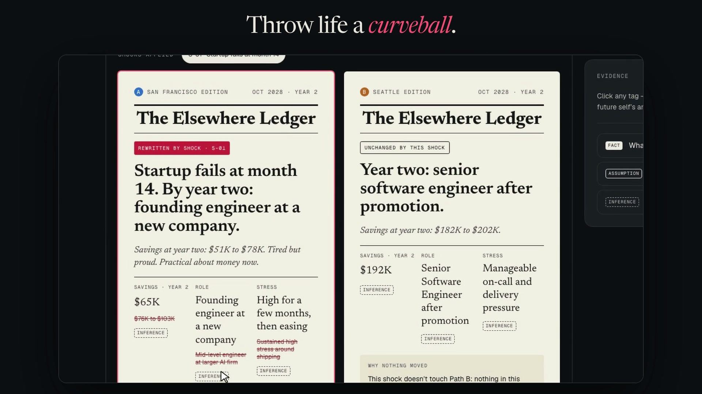
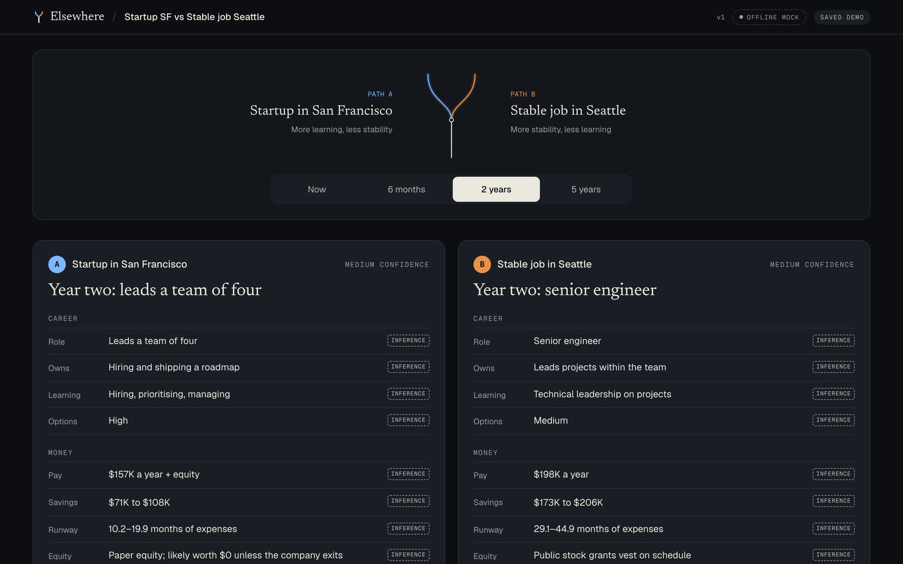
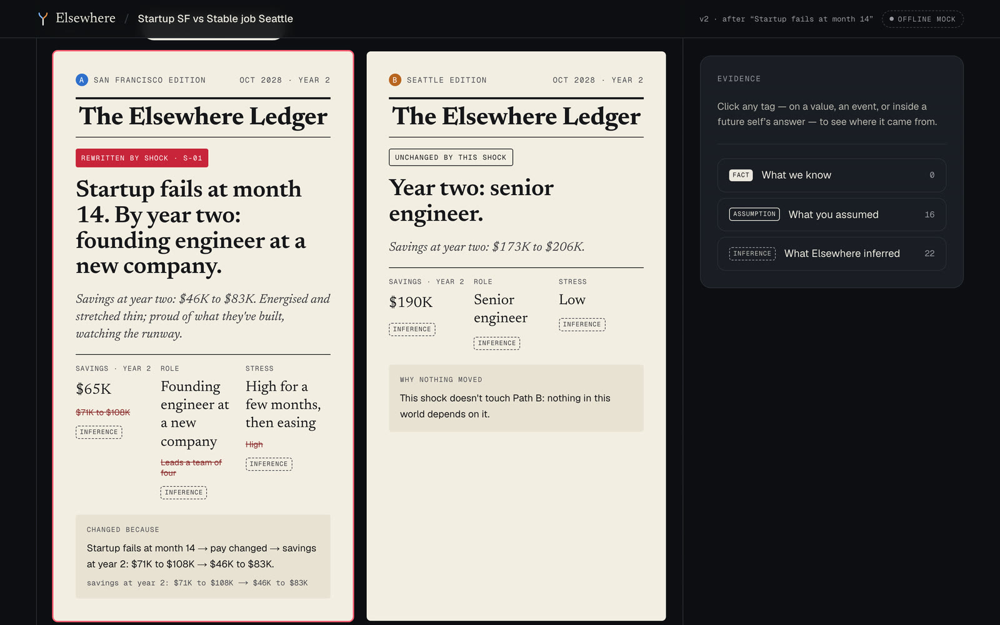
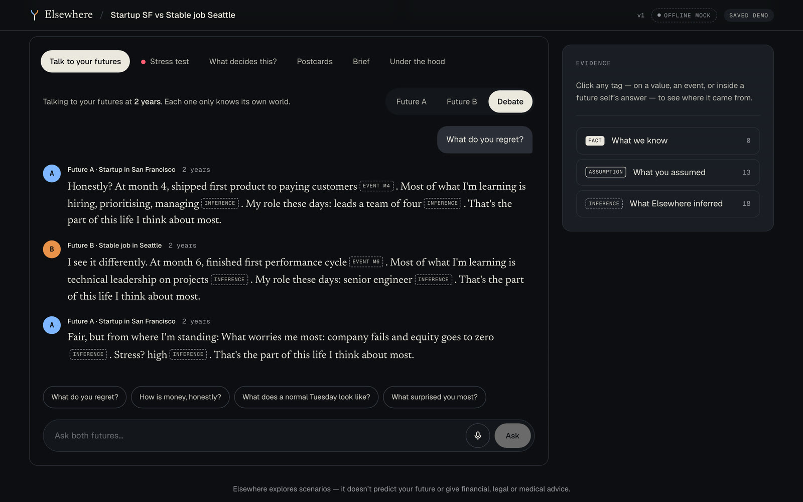
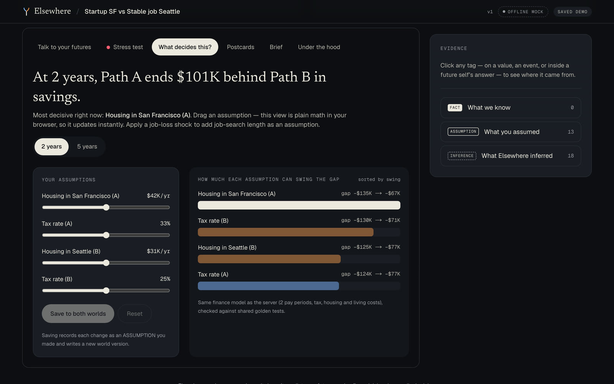
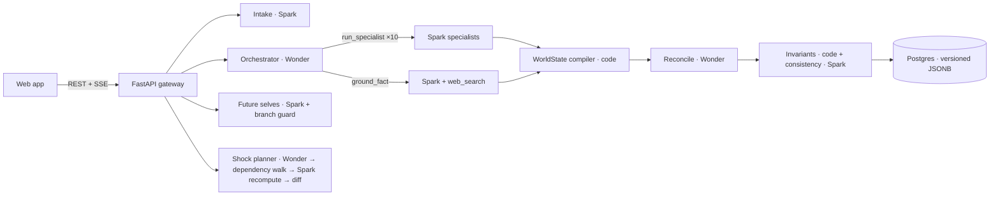

<div align="center">

# Elsewhere

### See the life you *didn’t* choose.

**One decision → two simulated futures you can talk to, stress-test and fact-check.**

[](https://events.cerebralvalley.ai/e/meta-ai-developer-hackathon)


<a href="docs/media/elsewhere-launch.mp4"></a>

▶ **[Watch the 25-second launch film](docs/media/elsewhere-launch.mp4)** · 🎬 **3-minute demo video:** _coming soon_ · 🌐 **Live demo:** _coming soon_

</div>

> Elsewhere explores scenarios. It does not predict your future, and it isn’t financial, legal, medical or immigration advice.

---

## 💡 Inspiration

Every big choice leaves a life behind. Startup or stable job. Nursing school or keep the paycheck. Take the job in the Gulf or stay near family in Kerala. Most people make these calls on gut feel and a pros-and-cons list, and only a lucky few have an advisor to think it through with.

Chatbots will happily tell you a confident story, but they blur three different things into one smooth paragraph: **facts**, **your own assumptions**, and **pure guesswork**. I wanted the opposite: show both lives side by side, keep them strictly separate, and label every claim with where it came from.

## 🔀 What it does

| | |
|---|---|
| **Decide** | Type or *say* the choice that keeps you up at night. An intake agent asks at most 3 questions, and only the ones that would change the result most. |
| **Two futures, side by side** | Elsewhere forks your life into Future A and Future B: career, money, lifestyle, risk and values, from *Now* to *5 years*. |
| **Talk to both of you** | Chat with either future self, or put them in the same room in **debate mode**. Each one only knows its own world. |
| **Throw life a curveball** | Apply a shock (“startup fails at month 14”) and only what’s downstream recomputes. It lands as two **newspaper front pages from year two**, with a causal chain for every change. |
| **Know what to trust** | Every value is tagged **FACT** (a web search ran and returned a source), **ASSUMPTION** (you said it) or **INFERENCE** (the model reasoned it). |
| **What decides this?** | A tornado chart ranks which assumption swings the outcome most. Drag a slider and the money math updates instantly. |
| **Find the third door** | Muse Wonder checks whether A-or-B is a false choice and proposes one realistic hybrid path you can simulate in one click. |
| **1,000 lives in a second** | Both worlds rolled through a thousand random lives (layoffs, medical bills, rent jumps, raises) right in the browser. |
| **Postcards from elsewhere** | Muse Image paints a postcard from each world, generated from that world’s actual state. |
| **Bring people in** | A read-only **Ask friends** link where friends vote on which life fits you, plus a printable **counselor handout** for mentors and caseworkers. |

<p align="center">
  
  
  
  
</p>

## 🛠 How I built it

### Meta models, and why each one is needed

| Model | Model ID | Job in Elsewhere |
|---|---|---|
| **Muse Wonder** | `muse-wonder-1.0` | Orchestrator: plans both worlds, delegates to Spark through function tools (parallel tool calls), reconciles them, plans shocks and proposes the third door. Long-horizon consistency is the hard part, and Wonder owns it. |
| **Muse Spark** | `muse-spark-1.3` | 10 specialist agents per simulation, evidence resolver, consistency checker, the future selves (streamed), branch-guard repairs and the front-page writer. |
| **Web grounding** | `web_search` tool on Spark | Current public facts (rent, tax). A claim only becomes a FACT if a search actually ran *and* returned a source. |
| **Muse Voice Transcribe** | `muse-voice-transcribe-1.0` | Voice intake and voice questions. |
| **Muse Image** | `muse-image-1.0` | A postcard from each world, painted from that world’s state. |
| **MMS-TTS** (Meta, open source) | `facebook/mms-tts-eng` | The future selves’ voices, run on the user’s device with transformers.js, so it needs no server and costs nothing. Weights are CC-BY-NC 4.0, which is fine for this non-commercial demo. |

All calls use the **Responses API** with **strict structured output** (every agent returns schema-valid JSON), **prompt caching** (`prompt_cache_key` per role) and per-role **reasoning effort**. Every call is logged with tokens, cached tokens and latency, and the app’s **Under the hood** tab shows them.

### Architecture



**Design rule: models reason; code owns ids, provenance, money math and causality.**
- Evidence and event ids carry their branch letter (`ev_A_004`, `E-B-002`), so isolation between worlds is checked by code, not trust.
- Savings and runway come from a deterministic finance engine in Python with a TypeScript twin for the browser, both tested against the same golden fixtures.
- Shocks never overwrite history. Each one writes a new world version plus a diff whose every change traces back to the shock.

**Stack:** Next.js 16 · React 19 · Tailwind CSS 4 · NumberFlow · Motion · FastAPI · Python 3.11 · PostgreSQL · Playwright · GitHub Actions

## 🧗 Challenges I ran into

- **No sub-agent parameter.** The API has no built-in way to spawn sub-agents, so Wonder delegates through our own parallel function-tool loop (`run_specialist`, `ground_fact`).
- **Futures leaking into each other.** Future A kept “knowing” things about Future B. I fixed it with a sentence-level **branch guard**, which rewrites any sentence that reaches into the other world before it is sent.
- **Honest FACT labels.** Web search returns its sources on the search call itself rather than as inline citations, so the evidence resolver reads both before it lets anything become a FACT.
- **No hard spending cap on the API.** I built one: each call reserves its worst-case cost before it runs, real costs are recorded with a 15% margin, and a hard ceiling locks every live call across every process.
- **Voice formats.** Muse Voice wants mono PCM16 WAV, so the server converts browser audio with ffmpeg first.

## 🏆 Accomplishments I’m proud of

- A full simulation runs **10 specialist agents in parallel** under one orchestrator, and every value it shows can be traced to a fact, an assumption or an inference.
- Shocks recompute **only** what’s downstream, with a causal chain you can read.
- A useful **offline demo**: six seeded decisions (including three for people who rarely get an advisor: a Gulf construction job versus staying in Kerala, a nursing assistant weighing nursing-school loans, and a single parent choosing rideshare or warehouse work) load in under 2 seconds with no API key.
- Many features cost **zero model calls**: 1,000 futures, tipping points, values compass, “switch back?” door-closing meter and on-device voices.

## 📚 What I learned

Letting the model own the *reasoning* and code own the *bookkeeping* (ids, money, causality) is what makes a multi-agent system trustworthy. The models got much more reliable once they no longer had to keep numbers consistent across 10 agents.

## 🔭 What’s next

- iOS companion app
- Live deployment for judges
- Reality check-ins at scale: compare how life actually went with both simulated worlds

---

## ✅ Built during the hackathon

All code in this repository was written during the event (**Oct 26 – Nov 4, 2026**), and the commit history shows it. Before the event I only wrote planning material: the docs in [`docs/`](docs/) (API notes, schema spec, demo script, design direction) and a static design mock-up in [`design/board/`](design/board/). No product code from those was reused.

## 🚀 Run it locally

```bash
# API (Python 3.11)
cd services/api
python3 -m venv .venv && .venv/bin/pip install -r requirements.txt -r requirements-dev.txt
cp .env.example .env              # add MODEL_API_KEY for live Meta models; empty = labeled offline mock
.venv/bin/uvicorn elsewhere.main:app --reload --port 8000

# Web (Node 22, pnpm)
cd apps/web
cp .env.example .env.local
pnpm install && pnpm dev          # http://localhost:3000 → open /demo
```

**No key? No problem.** Without a key the API runs a **clearly labeled offline mock** with an “Offline mock” badge everywhere. The mock never invents FACTs: the only FACTs it shows come from a small checked fact library ([`reference_facts.py`](services/api/elsewhere/reference_facts.py)), where each figure (BLS, NCSBN, HUD, KFF, IRS, RBI, UAE labour law) has its source and the date it was checked.

**Spending safety.** Live calls happen only when `MODEL_MODE=live`, a key and `BUDGET_USD` are all set. Every call has a `max_output_tokens` cap, and the app refuses any call that could go over budget. Check spend any time at `GET /v1/budget`.

Regenerate the seeded demos with live models: `cd services/api && .venv/bin/python -m scripts.seed_demo`

## 🧪 Tests and evals

| What | Command |
|---|---|
| API: full flow (intake → simulate → shock → debate → assumptions → postcard), strict-schema rules, finance, dependency walk, branch guard, budget | `cd services/api && .venv/bin/pytest` |
| Web: browser finance engine matches the Python engine, plus 1,000 futures, tipping points and doors | `cd apps/web && pnpm test` |
| AI evals: branch separation, temporal order, money reconciles, shock causality, evidence labels, unknowns, persona isolation | `services/api/.venv/bin/python packages/evals/run_evals.py` |
| Browser smoke test (Playwright) | `services/api/.venv/bin/python tests/e2e/smoke.py` |

## 🗂 Repo layout

```
apps/web            Next.js 16 app (landing, demo, intake, workspace, share pages)
services/api        FastAPI gateway, agents, engine, store
packages/prompts    Versioned agent instructions (v1)
packages/evals      Golden finance fixtures + AI eval suite
demo                Seeded scenarios (load in < 2s, used as fallbacks)
docs                Planning docs (written before the event) and media
```

## ⚠️ Known limitations

- Single API process: SSE wake-ups, locks and rate limits live in memory. Fine for a demo, not for scale.
- The finance model is deliberately simple (pre-tax pay × effective tax rate, housing range, ±10% living costs). It shows *ranges*, not forecasts.
- The iOS companion is not built yet.

## 👤 Team

**Roszhan Raj** (solo): product, design, agents and full stack · [GitHub](https://github.com/roszhan2684)

## 📄 License

[MIT](LICENSE). Muse models are used through Meta’s Model API under Meta’s terms. MMS-TTS weights are CC-BY-NC 4.0. Elsewhere is an independent hackathon project and is not affiliated with or endorsed by Meta.
