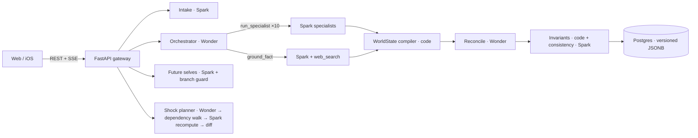

# Elsewhere — see the life you didn’t choose

**Elsewhere turns one decision into two simulated futures.** Talk to both versions of yourself, inject a shock and watch both worlds recompute, and check whether each claim is a grounded fact, your own assumption, or the model’s inference.

Built for the **Meta Global AI Developer Hackathon 2026** · Indie Developer track · *Build for Your World*

**Live demo:** _coming soon_ · **3-minute video:** _coming soon_

> Elsewhere explores scenarios. It does not predict your future, and it isn’t financial, legal, medical or immigration advice.

---

## How it works

1. **Decide.** Type or say the choice you’re stuck on. Muse Voice transcribes it, and a Muse Spark intake agent turns it into a structured decision. It asks at most 3 questions, only about the gaps that would change the simulation most.
2. **Simulate.** Muse Wonder plans two worlds and **delegates with function tools**. Our server runs 10 Muse Spark specialists in parallel (career, finance, lifestyle, risk and values, for both paths) plus web-search grounding calls. Code compiles a typed `WorldState`, Wonder reconciles both worlds, and code invariants plus a Spark consistency pass check everything before the UI renders it.
3. **Meet your futures.** Talk to Future A, Future B, or both at once in **debate mode**. Each future self only knows its own world. A **sentence-level branch guard** rewrites anything that reaches into the other world before it’s sent.
4. **Stress-test.** Apply a shock such as *“startup fails at month 14.”* Muse Wonder plans where the shock enters each world. A fixed dependency map in code finds every field downstream, and Spark recomputes only those fields, only after the shock month. The result appears as two **front pages from year two**, with a causal chain for every change.
5. **See what decides it.** A tornado chart ranks which assumption swings the outcome most. It runs the same finance engine in the browser, so dragging a slider updates instantly.

Every value carries a tag:
- **FACT** (solid): web search, with a citation
- **ASSUMPTION** (outlined): you said it or chose it
- **INFERENCE** (dashed): the models reasoned it, or the code calculated it

## Meta models, and why each one is needed

| Model | Model ID | Job in Elsewhere |
|---|---|---|
| Muse Wonder | `muse-wonder-1.0` | Orchestrator: plans, delegates to Spark through function tools (parallel tool calls), reconciles both worlds, plans shocks. Long-horizon consistency is the hard part, and Wonder owns it. |
| Muse Spark | `muse-spark-1.3` | 10 specialist agents per simulation, evidence resolver, consistency checker, the future selves (streamed), branch-guard repairs, front-page writer. Fast and cheap enough for high-volume loops. |
| Web grounding | `web_search` tool on Spark | Current public facts (rent, tax) with `url_citation`s. A claim only becomes a FACT if a search actually ran *and* returned a citation. |
| Muse Voice Transcribe | `muse-voice-transcribe-1.0` | Voice intake and voice questions (the server converts browser audio to WAV with ffmpeg). |
| Muse Image | `muse-image-1.0` | A postcard from each world, painted from that world’s state. |

All calls use the **Responses API** with **strict structured output** (every agent returns schema-valid JSON), **prompt caching** (`prompt_cache_key` per role), and per-role **reasoning effort**. Every call is logged with tokens, cached tokens and latency; the app’s “Under the hood” tab shows them.

## Architecture



**Design rule: models reason; code owns ids, provenance, money math and causality.**
- Evidence and event ids carry their branch letter (`ev_A_004`, `E-B-002`), so isolation is checked by code, not by trust.
- Savings and runway come from a deterministic finance engine (Python, with a TypeScript port for the browser). Both are tested against the same golden fixtures.
- Shocks never overwrite history. Each one writes a new world version and a diff whose every change traces back to the shock.

## What was built during the hackathon

All code in this repository was written during the event (Oct 26 – Nov 4, 2026). Before the event, I only wrote planning material: the docs in [`docs/`](docs/) (API notes, schema spec, demo script, design direction) and a static design mock-up in [`design/board/`](design/board/). No product code from those was reused; the app was built from scratch on the commits in this repo.

## Run it locally

```bash
# API (Python 3.11)
cd services/api
python3 -m venv .venv && .venv/bin/pip install -r requirements.txt -r requirements-dev.txt
cp .env.example .env              # add MODEL_API_KEY for live Meta models; empty = labeled offline mock
.venv/bin/uvicorn elsewhere.main:app --reload --port 8000

# Web (Node 22, pnpm)
cd apps/web
cp .env.example .env.local
pnpm install && pnpm dev          # http://localhost:3000
```

**Spending safety.** Meta Model API has no hard spending cap (its “spend limit” only sends an email), so Elsewhere enforces one. Live calls happen only when `MODEL_MODE=live`, a key, and `BUDGET_USD` are all set. Before each call, the app reserves that call's worst-case cost (every call has a `max_output_tokens` cap). It refuses any call that could go over the budget, and records real costs with a 15% margin in the `model_calls` table. Check it any time at `GET /v1/budget`.

Without a key, the API runs a **clearly labeled offline mock**: scripted stand-ins, never FACTs, and an “Offline mock” badge everywhere. With a key, everything is live.

Regenerate the seeded demos with live models: `cd services/api && .venv/bin/python -m scripts.seed_demo`

## Tests and evals

| What | Command |
|---|---|
| API: full flow (intake → simulate → shock → debate → assumptions → postcard), strict-schema rules, finance, dependency walk, branch guard | `cd services/api && .venv/bin/pytest` |
| Web: browser finance engine matches the Python engine | `cd apps/web && pnpm test` |
| AI evals: branch separation, temporal order, money reconciles, shock causality, evidence labels, unknowns, persona isolation | `services/api/.venv/bin/python packages/evals/run_evals.py` |
| Browser smoke test (Playwright) | `services/api/.venv/bin/python tests/e2e/smoke.py` |

## Repo layout

```
apps/web            Next.js 16 app (landing, demo, intake, workspace)
services/api        FastAPI gateway, agents, engine, store
packages/prompts    Versioned agent instructions (v1)
packages/evals      Golden finance fixtures + AI eval suite
demo                Seeded scenarios (load in < 2s, used as fallbacks)
docs                Planning docs (written before the event)
```

## Known limitations

- Single API process: SSE wake-ups, locks and rate limits live in memory. Fine for a demo, not for scale.
- The finance model is deliberately simple (pre-tax pay × effective tax rate, housing range, ±10% living costs). It shows *ranges*, not forecasts.
- The iOS companion is not built yet.
